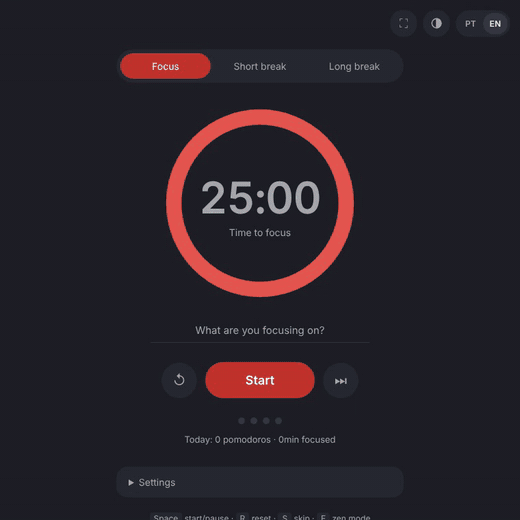

# 🍅 Pomodoro Timer

[](https://github.com/vieira-security/pomodoro-timer/actions/workflows/ci.yml)
[](https://github.com/vieira-security/pomodoro-timer/actions/workflows/codeql.yml)


A minimal, distraction-free Pomodoro timer. Installable as an app (PWA), works offline, and has no frameworks, no build step, and no tracking.

**▶ Live demo: [vieira-security.github.io/pomodoro-timer](https://vieira-security.github.io/pomodoro-timer/)**

<p align="center">
  
</p>

## Features

| | |
|---|---|
| ⏱️ **Accurate timer** | Based on timestamps, not tick counting, so it stays correct when the tab sits in the background. The progress ring animates smoothly at 60 fps with `requestAnimationFrame`. |
| 📲 **Installable & offline** | PWA with a web manifest, maskable icons, and a service worker that uses a stale-while-revalidate cache. |
| 🧘 **Zen mode** | Fullscreen view that shows only the time. Press `F` to enter and `Esc` to leave. |
| 🔔 **Alarms** | Three synthesized alarm sounds (bell, digital, soft), each with a different melody for "focus ended" and "break ended". Includes a volume slider, a test button, system notifications, and vibration on mobile. |
| 🌧️ **Ambient sound** | Optional rain, white noise, or brown noise while you focus. Rain is a real 2:30 recording with a crossfaded seam, downloaded only when selected (~2.4 MB). The noises are generated with the Web Audio API and loop seamlessly. |
| 📊 **Daily stats** | "Today: 4 pomodoros · 1h 40min focused". Resets automatically at midnight. |
| ✍️ **Current task** | Type what you're working on. It shows in the tab title and in zen mode. |
| 🌗 **Themes** | Auto (follows the OS), light, or dark. Applied before the first paint, so the screen doesn't flash. |
| 🌐 **i18n** | Portuguese 🇧🇷 and English 🇺🇸. Detects the browser language on the first visit. |
| ⌨️ **Keyboard shortcuts** | `Space` start/pause · `R` reset · `S` skip · `F` zen mode |
| ♿ **Accessible** | Semantic HTML, labelled controls, visible focus, WCAG AA contrast, and support for `prefers-reduced-motion`. |
| 🔒 **Hardened** | Strict Content Security Policy, no user-input HTML sinks, zero runtime dependencies. See [Security](#security). |

## Tech stack

- **App:** vanilla HTML, CSS, and JavaScript. No dependencies, about 45 KB of code.
- **Tests:** [Playwright](https://playwright.dev/) + TypeScript
- **Quality gate:** [Lighthouse CI](https://github.com/GoogleChrome/lighthouse-ci)
- **Security:** CodeQL, Dependabot, SHA-pinned actions
- **CI/CD:** GitHub Actions → GitHub Pages

## Testing

The E2E suite has **45 scenarios**, and each one runs on **desktop and mobile** (Pixel 7) Chromium.

```bash
npm install
npx playwright install chromium
npm test            # run everything
npm run test:ui     # Playwright UI mode
npm run report      # open the last HTML report
```

### What's covered

| Spec | Covers |
|---|---|
| `timer.spec.ts` | countdown, pause/resume, reset, focus → short break → long break cycle, skip, background-tab accuracy, keyboard shortcuts |
| `settings.spec.ts` | durations (incl. boundary values), auto-start, alarm choice/volume persistence, alarm & vibration off, ambient sound only during focus |
| `features.spec.ts` | current task in tab title, daily stats reset at midnight, theme cycle & persistence, zen mode |
| `i18n.spec.ts` | language toggle, persistence, dynamic strings, browser-locale detection |
| `pwa.spec.ts` | manifest validity, icon availability, Open Graph tags, **works offline** after first visit |
| `audio.spec.ts` | rain recording is lazy-loaded and decodable, generated noises loop without a seam click, volume slider UI |
| `security.spec.ts` | CSP is strict and its hash matches the inline script, **zero CSP violations** while using every feature, XSS payload in the task field stays inert, scripts from other origins are blocked |

### How it's tested

- **Fake clock (`page.clock`):** a full 25-minute session runs in milliseconds. `runFor()` simulates real ticking. `fastForward()` simulates a throttled background tab waking up, which checks that the timer relies on timestamps and not on counting ticks.
- **Page Object + custom fixture** (`tests/fixtures.ts`): the fixture installs the clock before the page loads, spies on `navigator.vibrate`, and records the app's `pomodoro:*` custom events. Tests check *that the alarm fired and which sound* without trying to listen to audio.
- **Stable selectors:** every test uses `data-testid`, so changing the copy or the styles doesn't break tests.
- **Real offline check:** service workers are blocked by default and allowed only in the PWA spec. That spec uses `context.setOffline(true)` and reloads the page.

> 🐛 **Bugs the suite caught**
> - Typing `0` as the focus duration fell back to the default (25) instead of clamping to the minimum (1), because `parseInt("0") || 25` treats `0` as falsy. A boundary-value test exposed it.
> - On mobile, after scrolling, the fixed top bar (zen, theme, language) ended up *behind* the timer ring and couldn't be tapped. A security test that clicks through every feature on the Pixel 7 profile exposed it.

## CI/CD

Every push and every pull request runs [`.github/workflows/ci.yml`](.github/workflows/ci.yml):

```
┌──────────────┐   ┌──────────────────┐
│  E2E tests   │   │  Lighthouse CI   │   ← run in parallel
│ (Playwright) │   │ perf ≥ 95, a11y, │
│              │   │ BP, SEO = 100    │
└──────┬───────┘   └────────┬─────────┘
       └─────────┬──────────┘
                 ▼
        Deploy to GitHub Pages     ← main branch only, only if both pass
```

The HTML Playwright report (with traces from failed tests) and the Lighthouse reports are uploaded as build artifacts.

## Security

Static site, no backend, no cookies, no analytics, no third-party requests: user data never leaves `localStorage`. Still, it's hardened as if it mattered:

| Layer | Measure |
|---|---|
| Browser | Content Security Policy via `<meta>`: `default-src 'self'`, `object-src 'none'`, `base-uri 'self'`, `form-action 'none'`. The one inline script is allowed by **SHA-256 hash** (`npm run csp` recomputes it). No `unsafe-inline`/`unsafe-eval`. |
| Code | User input is rendered only with `textContent`. The only `innerHTML` writes are hard-coded strings. |
| Supply chain | Zero runtime dependencies. Every GitHub Action is **pinned to a full commit SHA**, workflows default to `contents: read`, `persist-credentials: false`, and Dependabot proposes updates weekly. |
| Static analysis | **CodeQL** (`security-extended`) scans the JS/TS code *and* the workflow files on every push, PR, and weekly. |
| Tests | `security.spec.ts` fails the build on any CSP violation, on an inert-XSS regression, or if the CSP hash goes stale. |

Known limitation: GitHub Pages can't send custom HTTP headers, so `frame-ancestors` (clickjacking) and HSTS preload aren't configurable. See [SECURITY.md](SECURITY.md) to report a vulnerability.

## Run locally

```bash
npm install
npm start          # http://localhost:4173
```

Or open `public/index.html` directly in a browser. The service worker only runs over `http(s)://`.

## Project structure

```
public/                  ← everything that gets deployed
├── index.html
├── styles.css
├── app.js               ← timer, audio engine, i18n, settings
├── sw.js                ← offline cache
├── sounds/rain.mp3      ← ambient rain (lazy-loaded)
├── manifest.webmanifest
├── og-image.png         ← link preview (1200×630)
└── icons/
tests/                   ← Playwright specs + fixtures/page object
scripts/
├── generate-assets.mjs  ← renders icons & OG image from SVG
├── record-demo.mjs      ← records docs/demo.gif
└── update-csp.mjs       ← recomputes the CSP hash
.github/workflows/      ← ci.yml (tests → Lighthouse → deploy), codeql.yml
lighthouserc.json
playwright.config.ts
```

## License

Code: [MIT](LICENSE) © Gabriel Vieira de Sousa

Rain recording ("Relaxing Rain") by Dragon Studio, from [Pixabay](https://pixabay.com/), used under the [Pixabay Content License](https://pixabay.com/service/license-summary/). It was trimmed, crossfaded into a loop, and loudness-normalized.
